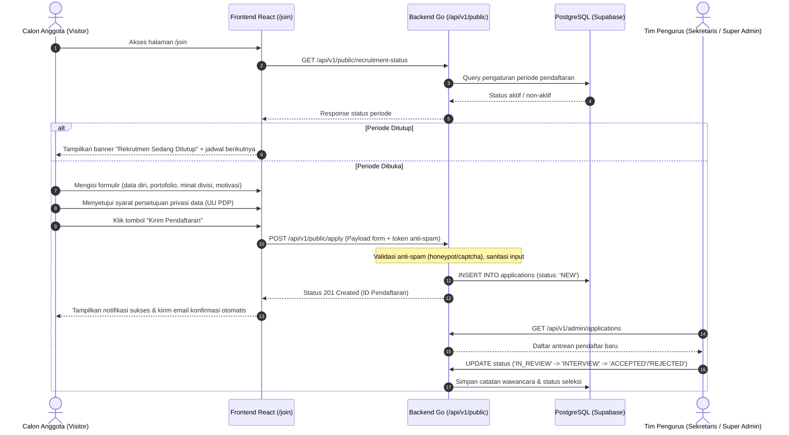
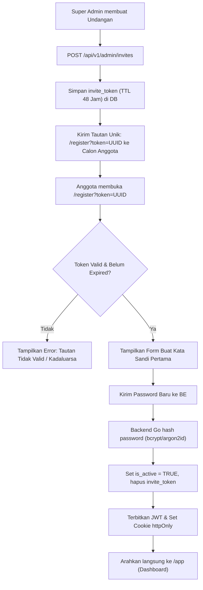
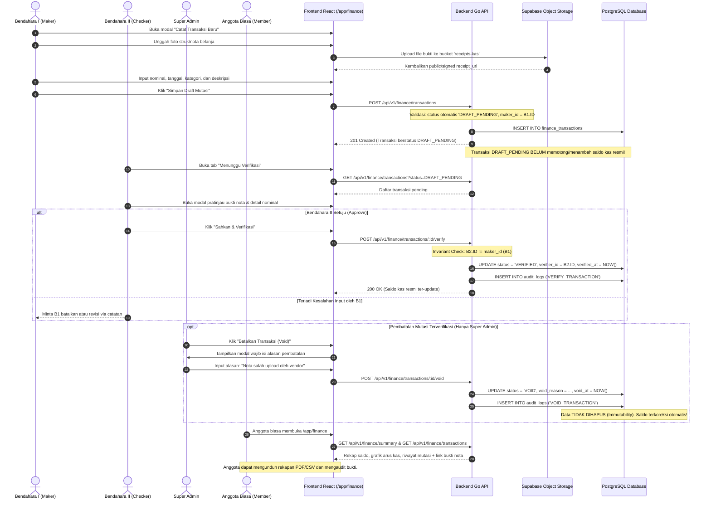
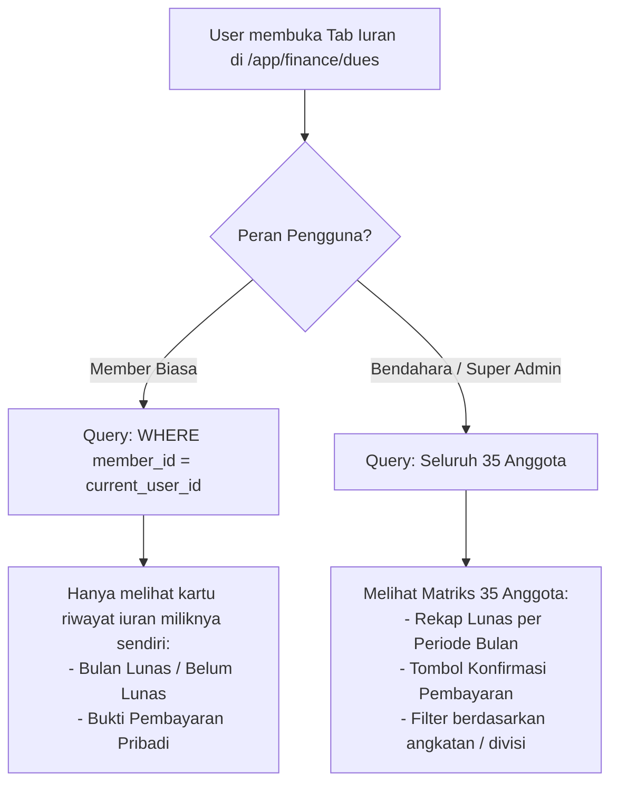
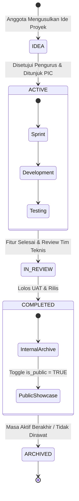

# USER JOURNEY & SYSTEM WORKFLOW — Website NCD (FLOW.md)

| Metadata | Nilai |
| :--- | :--- |
| **Versi** | 1.0.0 |
| **Tujuan** | Standarisasi peta navigasi, alur interaksi pengguna, dan transisi status sistem agar alur aplikasi terstruktur, terprediksi, dan tidak tumpang-tindih. |
| **Target Pengguna** | Pengunjung Umum (Visitor), Calon Anggota (Applicant), Anggota (Member), Sekretaris, Bendahara I & II, Super Admin |

---

## 1. Peta Navigasi Global (Global Sitemap & Routing Map)

Platform dibagi menjadi 2 zona utama dengan batas autentikasi yang tegas:

```mermaid
flowchart TD
    User["Pengguna Web"] --> Choice{"Status Sesi"}
    
    %% Public Zone
    Choice -->|"Tanpa Login (Publik)"| PublicZone["Zona Publik (Unauthenticated)"]
    PublicZone --> P_Home["/ (Beranda)"]
    PublicZone --> P_About["/about (Tentang & Visi-Misi)"]
    PublicZone --> P_Team["/team (Struktur & Galeri 35 Anggota)"]
    PublicZone --> P_Projects["/projects (Katalog Portofolio Proyek)"]
    PublicZone --> P_ProjDetail["/projects/:slug (Detail Proyek)"]
    PublicZone --> P_Competitions["/competitions (Prestasi & Lomba)"]
    PublicZone --> P_History["/history (Timeline Jejak Sejarah)"]
    PublicZone --> P_News["/news (Warta & Artikel Publik)"]
    PublicZone --> P_Join["/join (Formulir Pendaftaran Terbuka)"]
    PublicZone --> P_Rules["/rules (Ringkasan Kode Etik Publik)"]
    PublicZone --> P_Login["/login (Portal Masuk Anggota)"]
    PublicZone --> P_Register["/register?token=... (Aktivasi Undangan)"]

    %% Portal Zone
    Choice -->|"Terotentikasi (Cookie httpOnly)"| PortalZone["Zona Portal Member (/app/*)"]
    PortalZone --> M_Dashboard["/app (Dashboard Personal)"]
    PortalZone --> M_Projects["/app/projects (Manajemen Proyek Kanban)"]
    PortalZone --> M_Competitions["/app/competitions (Tracker Deadline Lomba)"]
    PortalZone --> M_Finance["/app/finance (Transparansi Kas & Iuran)"]
    PortalZone --> M_News["/app/news (Pengumuman Internal)"]
    PortalZone --> M_Documents["/app/documents (Arsip Berkas & AD/ART)"]
    PortalZone --> M_Profile["/app/profile (Profil & Pengaturan Privasi)"]
    
    %% Admin Only
    PortalZone -->|"Role: SUPER_ADMIN"| A_Admin["/app/admin (Manajemen Anggota, Role, Audit)"]
```



---

## 2. Alur Pengunjung Publik & Rekrutmen (Visitor & Application Flow)

Alur calon pendaftar mulai dari mempelajari kredibilitas NCD hingga mengirim formulir seleksi:



---

## 3. Alur Autentikasi & Aktivasi Akun (Auth & Onboarding Flow)

Sistem pendaftaran anggota **tidak terbuka untuk publik**, melainkan berbasis undangan (*invite-only*):



### Alur Login Reguler:
```
[Halaman /login] ──> Input Email + Password ──> POST /api/v1/auth/login
                           │
             ┌─────────────┴─────────────┐
             ▼                           ▼
      [Kredensial Valid]         [Kredensial Salah]
             │                           │
  Akun Aktif (is_active)?         Tolak: 401 Unauthorized
   ├── Tidak ──> 403 Deactivated  (Tampilkan pesan error)
   └── Ya ──> Terbitkan JWT
             Set Cookie: access_token
             Redirect ke /app
```

---

## 4. Alur Transparansi Kas: Tata Kelola Maker-Checker (FR-FIN)

Modul keuangan menerapkan prinsip pemisahan wewenang yang tidak dapat dilanggar (*anti-fraud*):



---

## 5. Alur Buku Iuran Anggota & Proteksi Privasi (UU PDP)

Menjaga transparansi tanpa melanggar privasi individual antar anggota:



---

## 6. Siklus Hidup Proyek & Prestasi (Project & Competition Lifecycle)

Alur manajemen karya internal hingga dipamerkan ke etalase publik:



### Transisi Prestasi Kompetisi (Competition to Hall of Fame):
```
[Rencana Ikut Lomba] ──> Status: PLANNING
          │
          ▼
[Pendaftaran & Submisi Berkas] ──> Status: REGISTERED / ONGOING
          │
          ▼
[Pengumuman Hasil Lomba] ──> Status: COMPLETED
          │
     ┌────┴────────────────────────┐
     ▼                             ▼
[Meraih Juara / Finalis]     [Belum Juara]
     │                             │
Terbitkan ke Hall of Fame     Tersimpan sebagai arsip internal
(achievement_level dicatat)
Muncul di /achievements
```

---

## 7. Penanganan Kondisi Error & Status Khusus (Error Handling States)

Untuk menjaga keandalan antarmuka dan kepuasan pengguna, setiap halaman menerapkan 4 status standar:

| Kondisi Sistem | Tampilan Antarmuka (UI State) | Tindakan Pengguna (Recovery Action) |
| :--- | :--- | :--- |
| **Data Sedang Dimuat (Loading)** | Skeleton placeholder halus beranimasi pulsa (sesuai tata letak kartu). | Otomatis berganti saat request selesai. |
| **Data Kosong (Empty State)** | Ilustrasi minimalis + teks informatif: *"Belum ada proyek aktif pada kategori ini"*. | Tombol CTA relevan (misal: "Buat Proyek Baru" bagi pengurus). |
| **Sesi Habis (401 Unauthorized)** | Modal pemberitahuan: *"Sesi Anda telah berakhir"* + redirect halus ke `/login`. | Pengguna masuk kembali; form input terakhir dicadangkan di memory. |
| **Akses Ditolak (403 Forbidden)** | Tampilan halaman khusus: *"Anda tidak memiliki wewenang untuk mengakses modul ini"*. | Tombol *"Kembali ke Dashboard Utama"*. |
| **Server Gangguan (500 Internal)** | Alert peringatan dengan tombol coba lagi: *"Gagal menghubungi server Go API"*. | Tombol *"Muat Ulang Data (Retry)"* memicu invalidasi query TanStack. |
| **Halaman Tidak Ditemukan (404)** | Halaman ramah bertema NCD dengan tautan kembali ke Beranda publik. | Link navigasi cepat ke Beranda, Proyek, dan Kontak. |

---

## 8. Ringkasan Guard & Middleware Aturan Rute

```
HTTP Request
     │
     ▼
[Next / React Router]
     │
     ├── Path: / (Publik) ───────────────> Buka Langsung (Tanpa Guard)
     ├── Path: /login ───────────────────> Jika sudah ber-login, alihkan ke /app
     ├── Path: /register?token=... ──────> Validasi token di Backend Go
     │
     └── Path: /app/* (Portal Internal) ──> Cek Cookie 'access_token'
              │
              ├── Tidak Ada Token ───────> Redirect ke /login?redirect=/app/...
              ├── Token Tidak Valid ─────> Hapus Cookie & Redirect ke /login
              │
              └── Token Valid:
                   │
                   ├── Path: /app/admin ──> Cek Role: SUPER_ADMIN / GOD_ADMIN
                   │                         ├── Tidak -> 403 Forbidden
                   │                         └── Ya    -> Render Admin Hub
                   │
                   ├── Path: /app/finance -> Cek Role:
                   │                         ├── B1 -> Hak Input Mutasi
                   │                         ├── B2 -> Hak Verifikasi Mutasi
                   │                         └── Member -> Hak Baca Kas & Iuran Pribadi
                   │
                   └── Path: Modul Lain ──> Render Sesuai Hak Akses Modul
```
